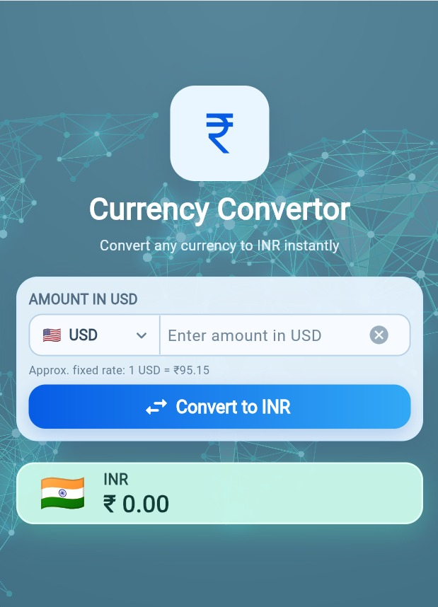
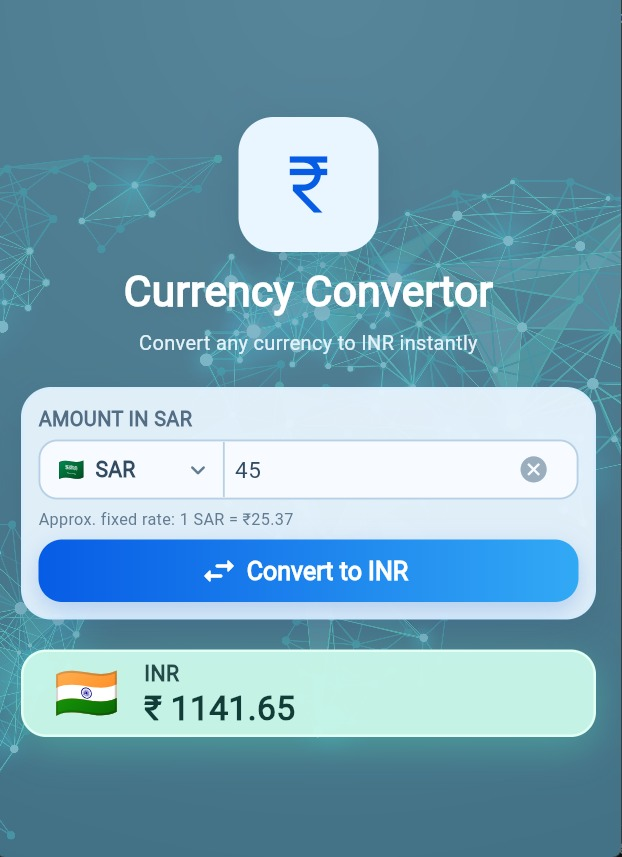
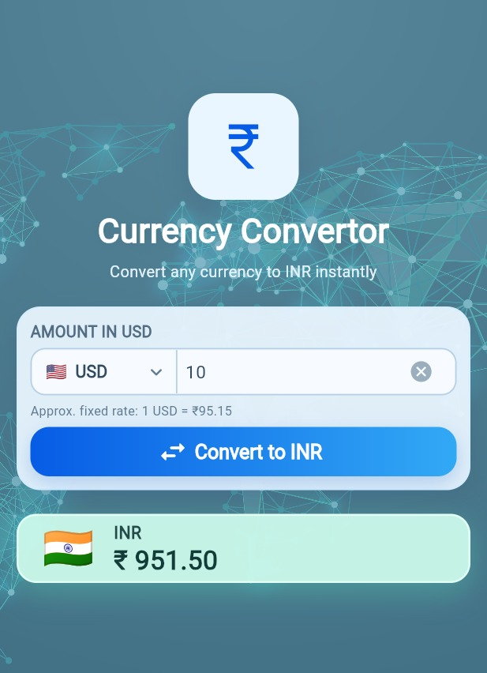

 # 💱 Currency Converter

A responsive Flutter application that converts foreign currencies into Indian Rupees (INR) with a simple and modern user interface.

## 📱 Project Overview
A Flutter-based currency converter supporting multiple currencies, amount input, and INR conversion.

## ✨ Features
- Convert USD, SAR, RUB, CNY, AED, and CAD to INR
- Currency selection with flags
- Input validation and clear button
- Responsive UI for mobile and desktop
- Modern design with background image and gradient buttons
- Displays converted amount in INR

## 🛠️ Tech Stack
- **Flutter**
- **Dart**
- Material Design
- Responsive layouts using `LayoutBuilder`

## 📂 Folder Structure
```text
currency_converter/
├── lib/
│   └── main.dart
├── assets/
│   └── background.jpg
├── web/
├── android/
├── pubspec.yaml
└── README.md
```

## 📸 Screenshots
### 🏠 Home Screen
 
<p align="center">
  
</p>
 

### SAR to INR


<p align="center">
  
</p>


### USD to INR
 
<p align="center">
  
</p>

## 🚀 Installation Steps

1. Clone the repository:
   ```bash
   git clone YOUR_GITHUB_REPOSITORY_URL
   ```
2. Open the project folder:
   ```bash
   cd currency_converter
   ```
3. Install dependencies:
   ```bash
   flutter pub get
   ```
4. Run the application:
   ```bash
   flutter run
   ```

## 👨‍💻 Author

**Bhupender**

- GitHub: [bhupender1208](https://github.com/bhupender1208)
- LinkedIn: [Connect with me](https://www.linkedin.com/in/bhupender-00b134282/)
- Email: bhupender00012@gmail.com

---

*Built with ❤️ using Flutter and Dart.*
